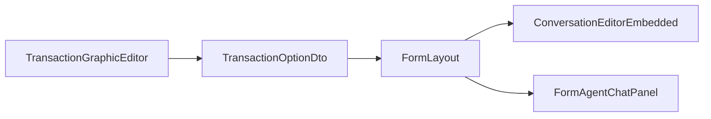
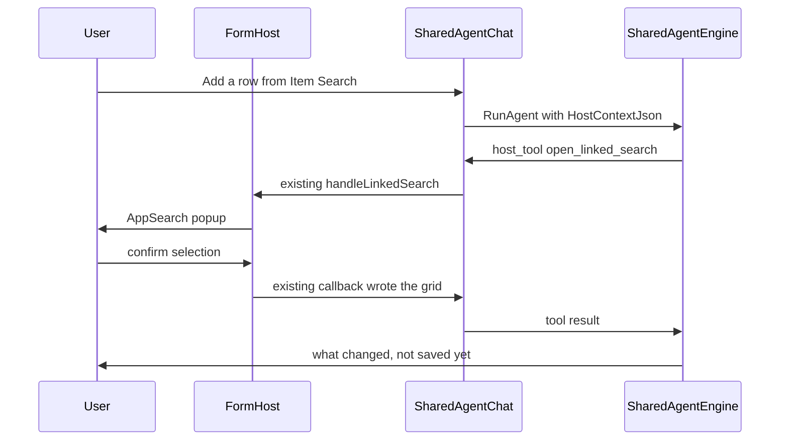

# Transaction Form AI Agent — Design Plan

**Status:** Implementation in progress. Catalog-only `HostContextJson` and Calculation-style apply agreed 2026-11-05 (sections 5 and 11). Apply migrations `V070__AppFormAgent_xhu.sql` then `V071` / `V072`.  
**Date:** 2026-11-03  
**Scope:** Master Detail and List Edit transaction forms. One shared Specialist. First delivery includes the AI panel, List Edit Communication, host tools, and seeded libraries.  
**Related:** Entity Lookup semantic match (exact → vector) is designed in `SharedAgentEngine-VectorStore-Architecture.md` (not implemented yet). Field/grid *addressing* still uses the unit catalog plus server-side match, not embeddings.

---

## 1. Goal

On a transaction form, the user can talk to an AI agent about that form. The agent sees the open form, its configuration, where the form was opened from, and the actions within about two clicks (linked searches, link targets, commands). It can open those actions, fill or change fields and grids, query data, call APIs, and render grids, cards, or charts. A chosen result or an AppFile can be written back onto the form.

The chat reuses the existing Shared Agent chat. It does not get its own chat product in the left menu.

First-delivery behavior:

- Linked Search and Link Target open the existing popups. The user confirms. The existing callback writes the result back.
- Field and grid edits appear on the form immediately. They are not saved automatically.
- Save, delete, and server commands ask the user first.
- Headless search that picks rows and writes them back without the popup is out of scope.

---

## 2. Where the panel sits

The switch is in `AppReact/src/components/transaction/ApplicationFormBuilder/TransactionGraphicEditor.tsx`.

- Master Detail: next to Enable Communication.
- List Edit (`EmTransactionOrganizedType.List = 3`): the same AI options, on their own. List Edit does not have Communication today; this plan adds it.

Flags live on `TransactionOptionDto` (`APP.Components.Dto/UserDefine/AppTrans/TransactionOptionDto.cs`), inside the existing `OtherOptions` JSON. No new table column.

- `IsEnableTransactionAiAgent`
- `IsOpenAiAgentByDefault`
- `AiAgentDockPosition` — used only when AI is on and Communication is off. Right or Bottom. Default Right.

The right dock is a full-height column. On a transaction form group it lines up with the record navigation bar (First / Prev / Next / Last), not with the form toolbar. On a form opened by itself it lines up with that form's toolbar. List Edit uses the same full-height column on `FormListEdit.tsx`.

Embedded in that dock, the chat is one column. The full-page Agent Chat stays left conversation and right tool rail.

```text
1. The form dock defaults to the conversation and the composer, using the full dock width. Buttons at the top act as sections and show one at a time: Chat, Tools, Files. Hide Files when that agent has no file tools. The full-page Agent Chat stays left conversation, right tool rail.

2. The Tools button pulses slowly while a tool is running. It does not keep a dot after the run. Tool calls are listed in the Tools section. Expand a row to see arguments and the result.

3. While files are being generated, the Files button pulses. When generation finishes, the pulse stops and a dot stays on the Files button. Opening Files clears the dot.

4. The Result open button stays in the conversation. Clicking it opens a window. A newly produced result opens that window automatically.

5. The result window covers the form body and is centered. It does not cover the conversation dock. It can go full screen, shrink back to that size, and close. Clicking outside it does not close it. Esc closes it.

6. Choosing a row or a card in the result window sends that choice back to the agent, which then writes a field or a grid.

7. ask_user stays in the conversation. It is not shown in the result window.

8. The dock has a full-screen button. Full screen uses the same layout as the full-page Agent Chat: conversation on the left, tool rail on the right. An open result moves into the right-hand Result tab and no longer covers the form. Leaving full screen returns to one section at a time.
```

- Communication only: the current message panel.
- AI only: Agent Chat in that panel.
- Both: one panel, two sub-tabs, Messages and AI. Dock follows Communication's `ConversationBoxDockPosition`. The last tab is stored in localStorage. The panel starts expanded when either "open by default" flag is true.

Transaction Editor does not pick an agent per transaction. Next to the AI switch, a "Configure Form Agent" link opens Agent Management for `app-transaction-form-agent`.



---

## 3. Which agent

This is a Specialist, not the General Agent. Every Master Detail record and every List Edit screen that turns AI on calls one AgentCode: `app-transaction-form-agent`. Seeded display name: **App Form Agent**. What changes per form is `HostContextJson` on each turn.

There is no binding table. The code is one shared constant, used by the form host, the sidebar filter, save, and delete.

`AgentCode` is already unique, so a second row with the same code cannot exist. Save and delete also block rename and delete:

- A new agent cannot use `app-transaction-form-agent`.
- Another agent cannot be renamed to that code.
- This agent's own code cannot be changed. Display name, prompt, and subscriptions can.
- It cannot be deleted. Block in `AppAgentSkillSetBL.TryDeleteSkillSet` and `UpsertSkillSet`. In Agent Management the code is read-only and there is no delete button. Same kind of protection as the General Agent.

An upgrade script inserts the agent, the `platform-form-host` tool rows, subscriptions, and the DDL exclusions with `IF NOT EXISTS`. Re-running the script does not overwrite a prompt or subscriptions an admin has already changed. These tools are not added to the General Agent allowlist (`AppGeneralAgentTool`).

Prompt and library subscriptions are edited in `AgentSkillSetManagement.tsx` (`agent-skill-management`).

`SharedAgentController.GetActiveAgents` excludes this code. It does not appear in the left menu or in Chat Management. Opening `/agent-chat?skillKey=app-transaction-form-agent` directly shows a short notice that this agent runs only inside a transaction form, and does not create an empty chat. Test Run inside Agent Management still opens. Host tools that need a form return `{ ok: false, error }` when no form is present.

The chat control is the existing `AgentUiChatHost` / `SharedAgentChat`. The form panel does not show the chat-list button.

---

## 4. Tools

Form actions are a new library. Query, API, and Grid / Card / Chart use libraries that already exist. Subscriptions are editable later in Agent Management. They are not added to the General Agent allowlist.

Do not subscribe `platform-transaction` or `platform-search`. The first edits form definitions. The second creates search screens. A linked search already configured on the form is opened by a host tool, through the existing popup.

New library `platform-form-host`, registered like V028. Each row is `AppAgentLibraryTool`:

- `ToolType = BuiltIn`
- `ToolConfig = {"TypeName":"App.BL.AIAgent.GenericAgent.Plugins.FormHostPlugin","MethodName":"OpenLinkedSearch"}`
- `ParameterSchemaJson` describes the arguments the model sees (`linkedSearchId`, `unitId`, `rowKey`, and so on)

Runtime path is unchanged: `SharedAgentEngine.WrapRegisteredTool` to `AppAgentToolEngine.Dispatch`, `BuiltIn` branch, `BuiltInToolExecutor` reflects into `FormHostPlugin`.

`set_fields`, `update_grid`, and `get_form_state` follow the **Calculation** round trip (section 11). They do not save the business record. Popup and command tools still wait on `AgentHitlBridge`:

1. The engine emits `host_tool` (tool name, raw arguments, requestId).
2. The open form POSTs **current `FormData` + tool + args** to `AppTransaction/ApplyFormAgentTool` (same idea as `ValidateAndCalculateTransactionData`).
3. `FormHostWriteBL` uses cached `AppTransactionExDto` (ControlType, EntityId, db names). It matches units/fields, coerces DDL / date / file values, applies match filters on grids, and returns the mutated DTO. No database write.
4. React replaces `currentFormData` with the response (bind only), then POSTs a small `{ ok, matched, applied }` JSON to `ConfirmHostTool` for the model.

If the bridge is empty (Agent Management test chat), the method returns `{ ok: false, error }`.

Host methods: `GetFormState`, `DescribeAction`, `SetFields`, `UpdateGrid`, `OpenLinkedSearch`, `OpenLinkTarget`, `RunCommand`. Mapping and coercion live in C#. The UI only posts FormData and rebinds.

One server read method, `ListAppFiles`, lists `AppFile` rows by keyword (FileId, name, whether it is an image). This is not `agent-files`. That library is the agent workspace only.

Seed subscriptions:

- `platform-form-host` — the methods above.
- `platform-database` — `execute_sql`, table schema, stored procedures. Exclude `create_database_table`, `alter_table`, `insert_mockup_data`, `confirm_drop_tables`.
- `platform-api-provider` — `api-provider-search`, then `api-provider-detail`, then `api-provider-execute`. Writes keep that library's existing confirmation.
- `data-analyze` and `platform-ui-render` — aggregation, and Grid / Card / Chart. A `render_interactive` button uses the existing `[ui_render_action]` turn, then `set_fields` or `update_grid`.

Reading live values is `get_form_state` (optional `unitId` + `match`). `HostContextJson` is a field/unit **catalog** only — no row values, no Entity item lists.

Example, "for each category I need, show the three best-value items": read the categories from the form grid, fetch candidates with `execute_sql` or an API, take the top three per category with `data_analyze`, and show them with `render_interactive` as cards or a grid. After the user clicks "add to the form", the agent calls `update_grid`. Picking an image is the same path: `ListAppFiles`, a card view (`CardImageLoader` already paints an AppFile id), the user clicks one, `set_fields` writes the FileId into the image field.

When the turn carries `HostContextJson`, do not append `AnalysisPathHardRule` from `SharedAgentEngine` (the "ask whether to build a KPI dashboard" gate). If the user already asked to compare or to chart, render it. A plain "show this" stays table or cards, with no dashboard question. A very large row count still uses the existing `confirm_row_limit` gate.

---

## 5. Context each turn

Unsaved values live only in the browser. Each `RunAgent` sends a compact **catalog** as `HostContextJson`. The engine injects it into that turn's system section (system prompt is rebuilt every turn, so send the catalog every turn). It is not stored in chat history. Do not send field values or grid rows in this JSON.

```json
{
  "form": "Sales Order",
  "pk": "SO-2026-00418",
  "transactionId": 1204,
  "mode": "master",
  "isDirty": false,
  "units": [
    {
      "unitId": 4401,
      "path": "Header",
      "kind": "one",
      "fields": [
        { "db": "OrderNo", "label": "Order No" },
        { "db": "CustomerId", "label": "Customer" },
        { "db": "Remark", "label": "Remark" }
      ]
    },
    {
      "unitId": 4402,
      "path": "Header / Order Line",
      "kind": "grid",
      "parentUnitId": 4401,
      "rowCount": 12,
      "fields": [
        { "db": "Sku", "label": "SKU" },
        { "db": "Qty", "label": "Qty" }
      ]
    },
    {
      "unitId": 4403,
      "path": "Header / Order Line / Allocation",
      "kind": "subgrid",
      "parentUnitId": 4402,
      "fields": [
        { "db": "WhseId", "label": "Warehouse" },
        { "db": "AllocQty", "label": "Alloc Qty" }
      ]
    }
  ]
}
```

- `kind`: `one` (root or sibling 1-1), `grid` (child), `subgrid` (grandchild under a grid row).
- Field entries are `{ db, label }` only. Do **not** put `entityId`, lookup item lists, ControlType, or current values here. The apply tool loads field structure from `AppTransactionExDto`.
- Grid `rowCount` is a hint. Rows are not included.
- Address for tools: `unitId` (or unit display name) + field `db`/`label` + optional `match` / `rowKey` / `parentRowKey`.
- Ambiguous names: `ask_user`. Do not guess.
- Form group: `{ "mode": "transactionFormGroup", "forms": [ /* one catalog per host */ ] }`.
- List Edit: `mode: "list"`, one unit of columns, `rowCount`, no row payload.
- Actions: keep a short `actions` list (id, kind, name, unitId) for Linked Search / Link Target / Command. Details via `describe_action`.

Example: “For Product Fabric BOM grid, set fabric as approved for fabric Woven ABC123.”

- Catalog maps “Fabric BOM” → grid `unitId`, “Fabric Code” / “Fabric Status” → `db`.
- Model calls `update_grid` once with `match: { FabricCode: "Woven ABC123" }` and `fieldsJson: { Status: "Approved" }`.
- Server finds the two matching rows among 100, coerces Approved → entity Id 1, patches FormData, returns it. The model never sees the 100 rows.

---

## 6. Chat id

`AppGenericAgentSession.SessionKey` is a global primary key, `NVARCHAR(200)`. TransactionId plus RootId alone would put two users on the same record into one row.

Saved Master Detail record, built from the signed-in user. No separate localStorage pointer:

`form-host:{userId}:{transactionId}:{rootPk}`

`rootPk` is the record's existing root value id, the same string Communication stores as `TransactionRootValueID`. The key is not parsed back apart. The client sends it on `RunAgent`. The server checks that the userId segment is the signed-in user and rejects the call if it is not. The existing insert-by-SessionKey path creates the row on the first message.

A new Master Detail record with no rootPk uses a per-tab guid:

`form-host:{userId}:{transactionId}:new:{tabGuid}`

After the first save, if the stable key has no session yet, move the draft messages onto the stable key. If the full key would exceed 200 characters, hash only `rootPk`. Keep userId and transactionId readable.

The same user opening the same record returns to the same chat. The form panel has no New Chat action.

List Edit has no single rootPk. Its chat key is:

`form-host:{userId}:{transactionId}:list`

The whole list shares one chat. Rows do not get their own chats.

---

## 7. List Edit

In the first delivery, with the same `app-transaction-form-agent`. No second agent.

Both the AI panel and Communication are added on `FormListEdit.tsx`, docked right or bottom. When both are on, the panel has Messages and AI sub-tabs. A List Edit opened from Master Detail, and a Mass Update of that same transaction, show the same panel when the switch is on.

Communication for a List Edit transaction is one thread for the whole transaction, not one thread per row. `AppMessage.TransactionRootValueID` is `nvarchar(200)` and has no foreign key to a data row. The panel passes the reserved value `__list__`. `ConversationEditorEmbedded` and the message queries stay as they are. The value is not numeric, so it cannot collide with a row primary key. Changing the selected row does not change the thread.

"Follow-up user from a transaction field" still reads a Master Detail record only. The List Edit editor does not offer that option. Group By only groups messages that already exist, so it can stay. Looking up a workflow by the reserved root finds nothing, so a list thread does not mix in one row's workflow messages.

`set_fields` updates the selected row or a named row. `update_grid` adds, edits, or removes list rows. Linked Search still opens the popup List Edit already uses.

---

## 8. What the form host does

The host sits on `FormMasterDetail` and `FormListEdit`.

- **set_fields / update_grid / get_form_state:** POST current FormData to `ApplyFormAgentTool` (section 11). Bind the returned FormData. Do not map columns in React.
- Open Linked Search: existing `handleLinkedSearch` / grid / List Edit popups. Tool returns after confirm or cancel. Write-back stays the existing callbacks.
- Open Link Target: `handleLinkTarget` / `executeUnitLinkTarget`. `IsPopup` unchanged.
- Command: Save, delete, and server commands go through `ask_user` first, then `handleCommandAction`. Refresh may run immediately.



---

## 11. Server apply (same pattern as Calculation)

Calculation today: client POSTs `currentFormData` to `ValidateAndCalculateTransactionData`; server mutates the DTO; response binds the UI; **no Save**.

Form-agent writes use the same pattern. The agent loop cannot see browser memory, so `host_tool` still wakes the page. The page then POSTs FormData; the server does the work; the page binds. The model only sees a small tool result.

```
LLM → update_grid / set_fields / get_form_state
  → host_tool
  → POST ApplyFormAgentTool { FormData, ToolName, Args, Mode }
  → FormHostWriteBL on AppMasterDetailDto / AppListDataDto
  → { FormData, ToolResult }
  → client currentFormData = FormData, IsDirty = true
  → ConfirmHostTool(ToolResult)
```

`FormHostWriteBL`:

- Load `AppTransactionExDto` from cache (`GetOnetHierarchyTranscationFromCache`).
- Map keys: `DataBaseFieldName`, `DisplayName`, then stem (`ColorId` → Color lookup, not ColorCode). Ambiguous → error.
- Coerce from ControlType: Entity/SearchAble DDL display → Id (`GetLookupItemList` exact match today; planned exact → vector via `SharedAgentEngine-VectorStore-Architecture.md`); numeric Id kept; Date / DateTime parsed; File / Image stored as the given FileId.
- `update_grid` `op=update` with `match` (e.g. `{ "FabricCode": "Woven ABC123" }`) updates **every** matching row. Optional `parentRowKey` for subgrid. `op=add` still takes a JSON **array** of rows in one call. `op=delete` uses `match` or `rowKey`.
- `get_form_state` returns a value slice (optional `unitId`, `match`, `take`). It does not dump the catalog again.
- Do not call `ValidateAndCalculateMasterDetailTransactionData` on every agent write (would drop UI-only state). Formula pass stays later.
- Linked Search / Link Target / command popups stay on the host.

Matching 100 grid rows is an in-memory filter on posted FormData. Semantic Entity Lookup (DDL Display → Id) is covered by `SharedAgentEngine-VectorStore-Architecture.md`, not by grid addressing.

## 9. Out of scope

- Headless search that applies a mapping and writes rows with no popup.
- A different agent per transaction.
- A binding table, or pointing some other agent at the form.
- Listing this agent in the left menu or in Chat Management.
- Deleting `app-transaction-form-agent`, or changing its AgentCode.
- Subscribing `platform-transaction`, `platform-search`, or the `platform-database` tools that create, alter, or drop tables.
- A separate agent on the Transaction Form Group shell.
- A second agent for List Edit.
- Letting the agent edit form design (fields, layout, or linked-search configuration).
- Per-row Communication on List Edit.
- "Follow-up user from a transaction field" on List Edit.

---

## 10. Implementation order

1. Add the AI flags and dock to `TransactionOptionDto`, and show them in the Transaction Graphic Editor for Master Detail and List Edit.
2. Shared dock on Master Detail (Messages, AI, or both tabs) and the same dock on List Edit, including List Communication with root `__list__`. Embed `AgentUiChatHost`.
3. Upgrade script: seed `app-transaction-form-agent`, `platform-form-host`, subscriptions, and DDL exclusions. Block rename and delete of that code.
4. Build catalog-only `HostContextJson` on each turn and inject it into that turn's system section only.
5. `host_tool` bridge: popups and commands on the host; `set_fields` / `update_grid` / `get_form_state` POST FormData to `ApplyFormAgentTool` (section 11).
6. `FormHostWriteBL` mutates the posted DTO (match, coerce). Formula recalculation of dependent columns is not part of this step.
