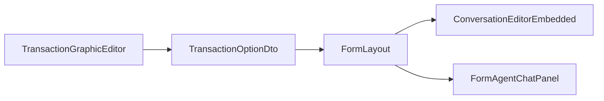
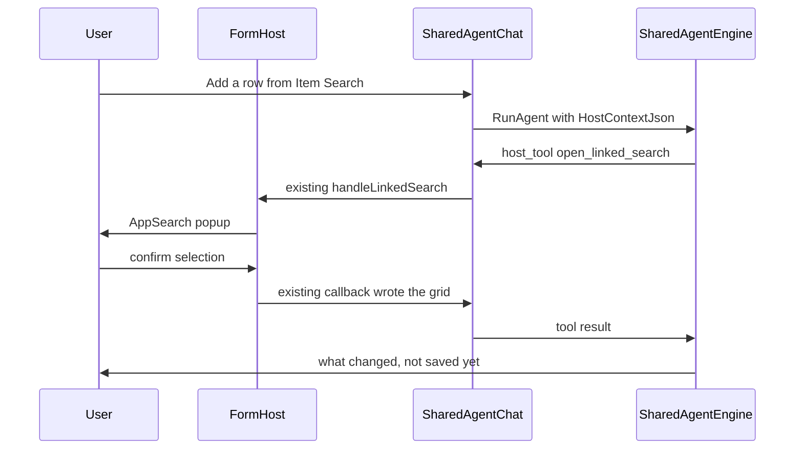

# Transaction Form AI Agent — Design Plan

**Status:** Implementation started (2026-11-03). Apply migration `V070__AppFormAgent_xhu.sql` before using the agent.  
**Date:** 2026-11-03  
**Scope:** Master Detail and List Edit transaction forms. One shared Specialist. First delivery includes the AI panel, List Edit Communication, host tools, and seeded libraries.

---

## 1. Goal

On a transaction form, the user can talk to an AI agent about that form. The agent sees the open form, its configuration, where the form was opened from, and the actions within about two clicks (linked searches, link targets, commands). It can open those actions, fill or change fields and grids, query data, call APIs, and render grids, cards, or charts. A chosen result or an AppFile can be written back onto the form.

The chat reuses the existing Shared Agent chat. It does not get its own chat product in the left menu.

First-delivery behavior:

- Linked Search and Link Target open the existing popups. The user confirms. The existing callback writes the result back.
- Field and grid edits appear on the form immediately. They are not saved automatically.
- Save, delete, and server commands ask the user first.
- Headless search that picks rows and writes them back without the popup is out of scope.

---

## 2. Where the panel sits

The switch is in `AppReact/src/components/transaction/ApplicationFormBuilder/TransactionGraphicEditor.tsx`.

- Master Detail: next to Enable Communication.
- List Edit (`EmTransactionOrganizedType.List = 3`): the same AI options, on their own. List Edit does not have Communication today; this plan adds it.

Flags live on `TransactionOptionDto` (`APP.Components.Dto/UserDefine/AppTrans/TransactionOptionDto.cs`), inside the existing `OtherOptions` JSON. No new table column.

- `IsEnableTransactionAiAgent`
- `IsOpenAiAgentByDefault`
- `AiAgentDockPosition` — used only when AI is on and Communication is off. Right or Bottom. Default Right.

The shell stays the right or bottom dock already used by `MasterDetailEditLayoutForm.tsx` (collapse and width unchanged). List Edit gets the same shell on `FormListEdit.tsx`.

- Communication only: the current message panel.
- AI only: Agent Chat in that panel.
- Both: one panel, two sub-tabs, Messages and AI. Dock follows Communication's `ConversationBoxDockPosition`. The last tab is stored in localStorage. The panel starts expanded when either "open by default" flag is true.

Transaction Editor does not pick an agent per transaction. Next to the AI switch, a "Configure Form Agent" link opens Agent Management for `app-transaction-form-agent`.

---

## 3. Which agent

This is a Specialist, not the General Agent. Every Master Detail record and every List Edit screen that turns AI on calls one AgentCode: `app-transaction-form-agent`. Seeded display name: **App Form Agent**. What changes per form is `HostContextJson` on each turn.

There is no binding table. The code is one shared constant, used by the form host, the sidebar filter, save, and delete.

`AgentCode` is already unique, so a second row with the same code cannot exist. Save and delete also block rename and delete:

- A new agent cannot use `app-transaction-form-agent`.
- Another agent cannot be renamed to that code.
- This agent's own code cannot be changed. Display name, prompt, and subscriptions can.
- It cannot be deleted. Block in `AppAgentSkillSetBL.TryDeleteSkillSet` and `UpsertSkillSet`. In Agent Management the code is read-only and there is no delete button. Same kind of protection as the General Agent.

An upgrade script inserts the agent, the `platform-form-host` tool rows, subscriptions, and the DDL exclusions with `IF NOT EXISTS`. Re-running the script does not overwrite a prompt or subscriptions an admin has already changed. These tools are not added to the General Agent allowlist (`AppGeneralAgentTool`).

Prompt and library subscriptions are edited in `AgentSkillSetManagement.tsx` (`agent-skill-management`).

`SharedAgentController.GetActiveAgents` excludes this code. It does not appear in the left menu or in Chat Management. Opening `/agent-chat?skillKey=app-transaction-form-agent` directly shows a short notice that this agent runs only inside a transaction form, and does not create an empty chat. Test Run inside Agent Management still opens. Host tools that need a form return `{ ok: false, error }` when no form is present.

The chat control is the existing `AgentUiChatHost` / `SharedAgentChat`. The form panel does not show the chat-list button.

---

## 4. Tools

Form actions are a new library. Query, API, and Grid / Card / Chart use libraries that already exist. Subscriptions are editable later in Agent Management. They are not added to the General Agent allowlist.

Do not subscribe `platform-transaction` or `platform-search`. The first edits form definitions. The second creates search screens. A linked search already configured on the form is opened by a host tool, through the existing popup.

New library `platform-form-host`, registered like V028. Each row is `AppAgentLibraryTool`:

- `ToolType = BuiltIn`
- `ToolConfig = {"TypeName":"App.BL.AIAgent.GenericAgent.Plugins.FormHostPlugin","MethodName":"OpenLinkedSearch"}`
- `ParameterSchemaJson` describes the arguments the model sees (`linkedSearchId`, `unitId`, `rowKey`, and so on)

Runtime path is unchanged: `SharedAgentEngine.WrapRegisteredTool` to `AppAgentToolEngine.Dispatch`, `BuiltIn` branch, `BuiltInToolExecutor` reflects into `FormHostPlugin`.

Methods that change the open form do not read or write the business record in C#. They wait on the same bridge `ask_user` uses (`AgentHitlBridge` in `AgentAskUserPlugin`):

1. The engine emits a `host_tool` event (tool name, arguments, requestId).
2. `SharedAgentChat` on the form hands the request to `FormMasterDetail` or `FormListEdit`.
3. React calls the existing functions: change a field, change a grid, or open a Linked Search / Link Target popup.
4. The page POSTs the JSON result back. The C# method returns that JSON to the model.

If the bridge is empty (Agent Management test chat), the method returns `{ ok: false, error }`.

Host methods: `GetFormState`, `DescribeAction`, `SetFields`, `UpdateGrid`, `OpenLinkedSearch`, `OpenLinkTarget`, `RunCommand`. The UI code stays in React.

One server read method, `ListAppFiles`, lists `AppFile` rows by keyword (FileId, name, whether it is an image). This is not `agent-files`. That library is the agent workspace only.

Seed subscriptions:

- `platform-form-host` — the methods above.
- `platform-database` — `execute_sql`, table schema, stored procedures. Exclude `create_database_table`, `alter_table`, `insert_mockup_data`, `confirm_drop_tables`.
- `platform-api-provider` — `api-provider-search`, then `api-provider-detail`, then `api-provider-execute`. Writes keep that library's existing confirmation.
- `data-analyze` and `platform-ui-render` — aggregation, and Grid / Card / Chart. A `render_interactive` button uses the existing `[ui_render_action]` turn, then `set_fields` or `update_grid`.

Reading the open form does not need those libraries. Field values and a grid sample are already in `HostContextJson`. When the sample is short or the user just edited the form, the model calls `get_form_state`.

Example, "for each category I need, show the three best-value items": read the categories from the form grid, fetch candidates with `execute_sql` or an API, take the top three per category with `data_analyze`, and show them with `render_interactive` as cards or a grid. After the user clicks "add to the form", the agent calls `update_grid`. Picking an image is the same path: `ListAppFiles`, a card view (`CardImageLoader` already paints an AppFile id), the user clicks one, `set_fields` writes the FileId into the image field.

When the turn carries `HostContextJson`, do not append `AnalysisPathHardRule` from `SharedAgentEngine` (the "ask whether to build a KPI dashboard" gate). If the user already asked to compare or to chart, render it. A plain "show this" stays table or cards, with no dashboard question. A very large row count still uses the existing `confirm_row_limit` gate.

---

## 5. Context each turn

Current values and unsaved edits live in the browser (`FormMasterDetail` `dataModel.currentFormData`, or the List Edit list). Each `RunAgent` sends a `HostContextJson` built by the host. The engine injects it into that turn's system section. It is not written into chat history.

Each turn carries a catalog, not the full two-hop graph:

- This form: transactionId, name, rootPk, isNew, isDirty, where it was opened from (`param2`: link target or form group).
- Fields: unit, fieldId, dbName, label, type, current value.
- Grids: columns, row count, at most 20 rows. Say when the list is truncated. Further rows come from `get_form_state`.
- Action catalog: Linked Search, Link Target, and Command on this form. Each entry has id, name, host unit, what it needs, and what it writes back.
- Two hops: `describe_action` on a Link Target returns that target form's key fields and the names of its next actions. It does not preload the target record.

List Edit context is the list: columns, the selected row, at most 20 rows, and the Linked Search and Link Target configured on that list unit.

---

## 6. Chat id

`AppGenericAgentSession.SessionKey` is a global primary key, `NVARCHAR(200)`. TransactionId plus RootId alone would put two users on the same record into one row.

Saved Master Detail record, built from the signed-in user. No separate localStorage pointer:

`form-host:{userId}:{transactionId}:{rootPk}`

`rootPk` is the record's existing root value id, the same string Communication stores as `TransactionRootValueID`. The key is not parsed back apart. The client sends it on `RunAgent`. The server checks that the userId segment is the signed-in user and rejects the call if it is not. The existing insert-by-SessionKey path creates the row on the first message.

A new Master Detail record with no rootPk uses a per-tab guid:

`form-host:{userId}:{transactionId}:new:{tabGuid}`

After the first save, if the stable key has no session yet, move the draft messages onto the stable key. If the full key would exceed 200 characters, hash only `rootPk`. Keep userId and transactionId readable.

The same user opening the same record returns to the same chat. The form panel has no New Chat action.

List Edit has no single rootPk. Its chat key is:

`form-host:{userId}:{transactionId}:list`

The whole list shares one chat. Rows do not get their own chats.

---

## 7. List Edit

In the first delivery, with the same `app-transaction-form-agent`. No second agent.

Both the AI panel and Communication are added on `FormListEdit.tsx`, docked right or bottom. When both are on, the panel has Messages and AI sub-tabs. A List Edit opened from Master Detail, and a Mass Update of that same transaction, show the same panel when the switch is on.

Communication for a List Edit transaction is one thread for the whole transaction, not one thread per row. `AppMessage.TransactionRootValueID` is `nvarchar(200)` and has no foreign key to a data row. The panel passes the reserved value `__list__`. `ConversationEditorEmbedded` and the message queries stay as they are. The value is not numeric, so it cannot collide with a row primary key. Changing the selected row does not change the thread.

"Follow-up user from a transaction field" still reads a Master Detail record only. The List Edit editor does not offer that option. Group By only groups messages that already exist, so it can stay. Looking up a workflow by the reserved root finds nothing, so a list thread does not mix in one row's workflow messages.

`set_fields` updates the selected row or a named row. `update_grid` adds, edits, or removes list rows. Linked Search still opens the popup List Edit already uses.

---

## 8. What the form host does

The host sits on `FormMasterDetail` and `FormListEdit` and calls the functions that already exist.

- Set a field: `buildFormDataWithOneToOneValue` and `onDataModelChange`. On List Edit, the target is the selected row or the row named by the tool.
- Set a grid: the same `DictOneToManyFields` update `DataGridLayout` already uses. On List Edit, the list source is `ListData`.
- Open Linked Search: `FormMainMenus.handleLinkedSearch` or `DataGridLayout.executeLinkedSearch`, and the List Edit equivalents. The tool returns only after the user confirms or cancels. Write-back stays `applyLinkedSearchResultToRootRow`, `applyLinkedSearchAddRows`, `applyLinkedSearchUpdateHostRow`, or `applyLinkedSearchResultToListRow`.
- Open Link Target: `handleLinkTarget` or `executeUnitLinkTarget`. Popup versus new tab follows the existing `IsPopup` flag.
- Command: Save, delete, and server commands go through `ask_user` first, then `handleCommandAction`. Refresh may run immediately.

---

## 9. Out of scope

- Headless search that applies a mapping and writes rows with no popup.
- A different agent per transaction.
- A binding table, or pointing some other agent at the form.
- Listing this agent in the left menu or in Chat Management.
- Deleting `app-transaction-form-agent`, or changing its AgentCode.
- Subscribing `platform-transaction`, `platform-search`, or the `platform-database` tools that create, alter, or drop tables.
- A separate agent on the Transaction Form Group shell.
- A second agent for List Edit.
- Letting the agent edit form design (fields, layout, or linked-search configuration).
- Per-row Communication on List Edit.
- "Follow-up user from a transaction field" on List Edit.

---

## 10. Implementation order

1. Add the AI flags and dock to `TransactionOptionDto`, and show them in the Transaction Graphic Editor for Master Detail and List Edit.
2. Shared dock on Master Detail (Messages, AI, or both tabs) and the same dock on List Edit, including List Communication with root `__list__`. Embed `AgentUiChatHost`.
3. Upgrade script: seed `app-transaction-form-agent`, `platform-form-host`, subscriptions, and DDL exclusions. Block rename and delete of that code.
4. Build `HostContextJson` on each turn and inject it into that turn's system section only.
5. `host_tool` bridge: read state, edit fields and grids, open the existing Linked Search and Link Target popups, confirm Save / delete / server commands, list AppFiles, and write a render selection back onto the form.
